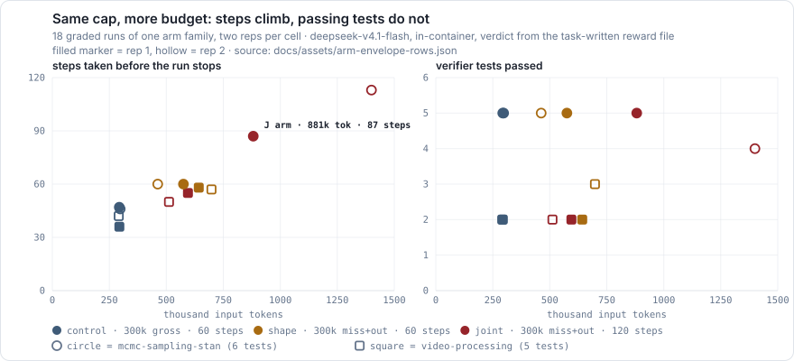
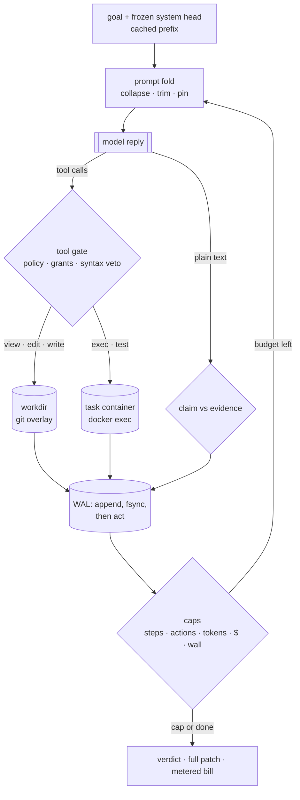
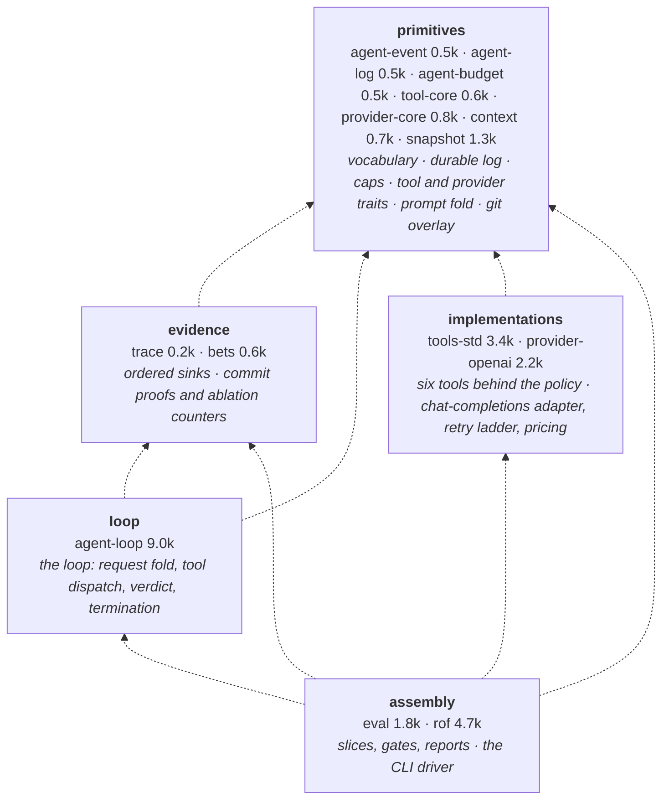

# rof

**A coding-agent harness that runs the agent inside the task's own container, unattended,
at flash-model prices** — and pays for that with the boring guarantees unattended runs need:
a write-ahead log written before every effect, rollback to the last proven hunk,
budgets denominated in dollars, and a verdict taken from the task's own verifier.

[](https://github.com/skadlem/rof-harness/actions/workflows/ci.yml)


| What it does | How it's judged | What it costs | What it refuses to be |
|---|---|---|---|
| Drives an OpenAI-compatible model through six tools against a scratch workdir, or inside the task's live container, until the work is done or a cap trips | The task's own verifier, run in the same container the agent worked in — not a wrapper's exit code | $0.006–$0.13 per task at flash-model tier; frontier harnesses report $6–$23 | A framework, a planner, an MCP host, or a hosted service. One binary, one loop |



*A real result from the rig, not an illustration: our own "more budget will fix it" hypothesis,
measured across 18 runs and killed. The figure is regenerated from the committed run data by
`tools/readme_chart.py`; the tables are transcribed from the arm reports.*

## Why running inside the container is the whole point

Most harnesses hand the agent a scratch directory and then copy files into a fresh container to
grade them. That bridge cannot represent *environment state*: a package the agent installed, a
server it started, a database it migrated are all invisible on the other side. Tasks that require
them are unwinnable for reasons that have nothing to do with the model.

This harness inverts it. `rof eval --agent --in-container` starts the task's own environment
container, runs the agent's tools *through* `docker exec` so installs and services persist, and
then runs the task's verifier in that same live container. On the frozen slice, the env-mutation
family (the verifier literally asserts "imported a package the agent installed" and "a port is
listening") went from **structurally 0/8 under file-copy grading to 8/8 in-container**, for
$0.11 across the eight cells.

> [!NOTE]
> The verdict is the **task-written reward file**, with the verifier's exit code only as a
> fallback. That is not pedantry: an audit found every task's `test.sh` ends with
> `echo … > reward.txt`, so it *always exits 0*. Exit-code grading reported 25/26 on that arm —
> the truth was 6/26. Every number below was re-derived from the reward files.

## How a run works



Three properties fall out of that shape, and they are why the loop stays small:

- **The log is the truth, the prompt is a view.** Every request is derived from an append-only
  log that is written and flushed *before* the effect it describes. A crash mid-run replays.
- **A failed batch cannot poison the tree.** Edits land in a git overlay; a batch that fails its
  proof rolls back, and the proven prefix survives as a savepoint.
- **Budgets are the kill switch, and they are priced.** Unknown costs are `null`, never `$0.00`,
  so a spend cap can never silently fail open.

## What's in the box

14 crates, 26.7k lines. Five layers, no cycles — and the layering is *checked*:
`tools/readme_chart.py crates` derives every crate-to-crate edge from the manifests and
fails if one points backwards or a crate is unbanded.



## What the rig has measured

Every row is one arm — a fixed model, endpoint, budget recipe and grading path. Arms are never
pooled, because they are not the same measurement.

| Arm | Result |
|---|---|
| 26-cell in-container slice, glm-5.3-flash (2026-10-12) | **6 Resolved / 19 Unresolved / 1 infra** — $0.76 total |
| File-artifact widening, 18 tasks | 4/18 solved, partial credit on 4 more |
| Env-mutation family (live servers, agent-installed packages) | **8/8** in-container; structurally 0/8 under file-copy grading |
| Cost per cell, flash-tier | $0.006–$0.13 vs $6–$23 per task for frontier-tier harnesses |
| Envelope arms: token-cap shape, miss-plus-out accounting, doubled step envelope (18 cells) | **Killed.** Walls move (47 → 60 → 87 → 113 steps, up to 4.8× gross input); capability doesn't — the same named test fails in every arm, and the deepest run loses one |
| Command-allowlist policy `--exec-policy any` (16 cells) | **Mechanism only.** Denials fall 3–9 per row to 0 at identical spend, and no test moves |
| Completion checklist in the goal (22 cells) | **Capability-positive, scoped.** Converts a deliverable that works where it was written but not where an evaluator runs it (5/6 → 6/6 solve); changes nothing on cells that fail on accuracy |
| `/app/…` file-tool parity (12 cells, two binaries) | **Correctness fix.** The largest denial class was agents refused the very files the task names; class eliminated, and the already-solved cell finishes in ~half the steps |

<details>
<summary><b>Receipts: how a cell is graded, and what "not comparable" means here</b></summary>

- **Two estimands, never mixed.** `HarborOracle` (`rof eval --agent`) grades by copying the
  workdir into a fresh container; `InContainerReward` (`--agent --in-container`) grades in the
  live container from the task's reward file. Rows carry the label; a table that mixes them
  would be lying quietly.
- **Taxonomy.** `Resolved | Unresolved | ErrorNoReport | EmptyPatch | InfraFailure | Ambiguous`.
  Infra failures are excluded loudly, never scored as capability — and that includes the
  harness's own failure modes, which are catalogued (root-owned artifacts surviving host-side
  rollback, verifier network timeouts, transport errors).
- **Statistics.** Wilson 95% intervals on every rate; a seeded paired bootstrap (no `rand`
  dependency) for comparisons; `Flaky` and saturation flags rather than silent averaging.
- **Provenance.** Every report self-describes: binary git sha, the resolved budget recipe, the
  token-cap shape, the exec policy, the apply mode, and the estimand. A row can be identified by
  its own file, without the driver script that produced it.
- **Frozen slices.** Task ids and `task.toml` digests are pinned in-tree; a re-frozen slice fails
  `cargo test` before any spend.

</details>

<details>
<summary><b>Receipts: the five arms behind the table above, and what each one cost</b></summary>

68 graded in-container cells in one session, one model (`deepseek-v4.1-flash`), one budget
recipe (300k tokens / 60 steps / 120 actions), one binary per arm, every row reward-graded:

```
arm              cells  verdict
dphn-cap            18  envelope axis dead: tests flat, 1.79x/3.05x tokens per test passed
dphn-trust          16  allowlist denials -> 0, tests unchanged
dphn-goalchk         6  checklist converted 5/6 -> 6/6 (the one capability-positive lever)
dphn-goalchk2       16  checklist does nothing on accuracy/correctness cells (scope found)
dphn-apppath        12  /app parity fixed; solved cell needs ~half the steps
```

The point of publishing this table is that four of the five arms are negative. A harness that
only shows you its wins cannot tell you which of its mechanisms actually work.

</details>

## Quickstart

```sh
cargo build -p rof
export OPENAI_API_KEY=...

# One agent run against a scratch repo; the full diff lands on stdout.
./target/debug/rof run --goal "fix the failing test" --workdir /tmp/w \
  --model <id> --endpoint https://api.deepseek.com/v1 \
  --allow-cmd "cargo test" --budget-steps 20

# Grade an agent inside the task's own container, from the reward file.
./target/debug/rof eval --agent --in-container --tasks-dir <tb-tasks> \
  --ids <task> --model <id> --endpoint <url> \
  --allow-cmd python3 --report out.json
```

Exit codes say what happened: `0` done, `2` usage, `3` run failure (halt, cancel, provider),
`4` missing credentials, `5` log failure, `6` snapshot failure, `7` empty input. `--dump-events`
writes the complete event log for replay.

## CLI

`rof run` — required: `--goal`, `--workdir`, `--model`.

| Flag | Meaning |
|---|---|
| `--endpoint URL` | OpenAI-compatible base URL (env `OPENAI_BASE_URL`) |
| `--allow-cmd CMD` | allowlisted command, repeatable (binary-prefix match) |
| `--exec-policy allowlist\|any` | `any` skips the list where the process boundary is elsewhere (in-container exec); recorded in provenance |
| `--budget-steps/-actions/-tokens N` | caps; any explicit flag lifts the 900s wall to 3600s |
| `--max-tokens N` | per-request output ceiling |
| `--context-file PATH` | pinned file context, repeatable |
| `--dump-events PATH` | full event log, one run one dump |
| `--log-path` / `--no-log` | WAL location (defaults to `<workdir>/.rof-events.jsonl`) |
| `--incentives base\|contract\|full` | prompt scaffold level |
| `--keep-thinking`, `--thinking-keep N`, `--collapse-hysteresis N` | transcript-shape knobs |
| `--pass-env NAME`, `--header NAME:VALUE`, `--api-key-env NAME` | provider plumbing |

`rof eval` adds `--tasks-dir DIR` (required), `--ids`, `--out-dir`, `--report`, `--winnability-only`,
`--lenient-apply`, `--agent`, `--in-container`. Without `--agent` it is a scaffold, not a grader.
Agent budgets default to 300k tokens / 60 steps / 120 actions.

<details>
<summary><b>Flags that exist but are off, and why</b></summary>

- `--compaction FRAC` — context checkpoints. Landed off; the registered validation arm turned out
  to be inert by construction (the trigger keys on per-request prompt size while the budget is
  cumulative billed tokens), so it awaits a redesign rather than a run.
- `--bets` / `--proof-cmd` — proof-gated batch commits and per-hunk savepoints. Zero gate
  interventions across six measured runs; available, unexercised, flagged.
- `--budget-shape miss-plus-out` — charges `(input − cache_read) + output` against the token cap.
  Mechanism confirmed, capability unconverted; a different estimand from `gross`, so the two never
  share a table.

</details>

## Boundaries

**Workdir contract.** `rof run` mutates `--workdir` in place. It refuses exactly four cases
(exit 2): the filesystem root, `$HOME`, the harness checkout itself, and a repo with uncommitted
changes unless `--allow-dirty-workdir` is passed. Everything else runs under the operator's
responsibility.

**Security posture, stated plainly.**

- File tools (`view`/`search`/`edit`/`write`) are root-anchored, symlink-safe, secrets-denied, and
  resolve `/app/…` to the workdir root so the workspace can be addressed the way task statements
  spell it. They are not a sandbox for `exec`.
- `exec`/`test` run allowlisted commands, but allowlisting is hygiene, not isolation: permitting
  `cargo test` or `sh` is arbitrary host code execution. `--exec-policy any` removes even that
  hygiene, for callers whose boundary is a container; the choice is recorded in every report.
- OS-level isolation — container, namespaces, network policy, memory caps — is the operator's job.
  The tools build no sandbox.
- Agent-spawned children run at `nice 19` so unattended sweeps yield to interactive work.

## Build, test, license

```sh
cargo test --workspace
cargo clippy --workspace --all-targets -- -D warnings
cargo fmt --all -- --check
```

CI runs all three on every push, plus a stale-reference grep over tracked files. The badge count
above is what `cargo test --workspace` reports today. Apache-2.0 — see [LICENSE](LICENSE).

<details>
<summary><b>Docs</b></summary>

- [`docs/architecture.md`](docs/architecture.md) — crate responsibilities and the loop's invariants
- [`docs/decisions.md`](docs/decisions.md) — decision log, with the measurement behind each entry
- [`docs/roadmap.md`](docs/roadmap.md) — what's next, spend-gated
- [`docs/threat-model.md`](docs/threat-model.md) — what the tools do and do not enforce

</details>
