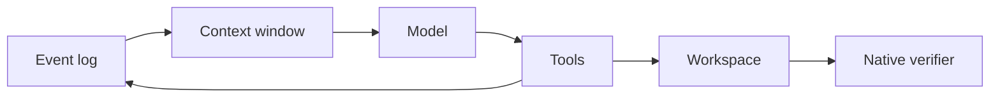

# ROF

**A Rust coding-agent harness built to close the gap between Flash-class and frontier models.**

[](https://github.com/skadlem/rof-harness/actions/workflows/ci.yml)

&nbsp; [Architecture](docs/architecture.md) · [Experiments](https://github.com/skadlem/rof-harness/blob/knowledge-vault-trial/docs/harness-experiments.md) · [Roadmap](https://github.com/skadlem/rof-harness/blob/knowledge-vault-trial/docs/research-next-steps.md)

## The harness

| Layer | What ROF controls |
|---|---|
| **Context** | Build each request from a durable event log. Keep recent observations and reasoning, collapse older output, and pin task context. |
| **Tools** | Inspect, edit, execute and test against the task workspace. Scope execution through a command allowlist. |
| **Loop** | Record tool calls before they run, roll back failed file batches, and enforce step, action, token and wall budgets. |
| **Evaluation** | Run in the task environment, grade with native verifiers, and record the runtime, configuration and provider usage for each trial. |



**Under evaluation** · Repository evidence search, archived output and bounded completion checks. [Experiments](https://github.com/skadlem/rof-harness/blob/knowledge-vault-trial/docs/harness-experiments.md)

## Results

| Experiment | Measured result |
|---|---|
| [Terminal-Bench 2.1 Slice A](https://github.com/skadlem/rof-harness/blob/knowledge-vault-trial/docs/experiments/2026-11-11-slice-a-faithful.md) | **5/18 solved** with DeepSeek Flash at a 300k gross-token run budget. |
| [Reasoning retention · Terminal-Bench 4.1](https://github.com/skadlem/rof-harness/blob/knowledge-vault-trial/docs/current-benchmark-pilot.md#wal-baseline-and-retention-ablations) | **Fail → pass** on WAL recovery with **19% fewer gross tokens**. One attempt per setting. |
| [Budget visibility · matched A/B](docs/budget-line-ab.md) | **1/4 vs 0/4** across two Slice A tasks. The treatment pass did not repeat. |

**Benchmark target** · Terminal-Bench 4.1 CPU. Matched ROF configurations use the same model and budget. Track native solves and tokens per solve. [Evaluation protocol](https://github.com/skadlem/rof-harness/blob/knowledge-vault-trial/docs/research-next-steps.md)

## Quickstart

Build with Rust and Cargo. Set `DEEPSEEK_API_KEY` in your environment before running.

```sh
cargo build --release -p rof

workdir=$(mktemp -d)
./target/release/rof run \
  --goal "Write a short README for this scratch project" \
  --workdir "$workdir" \
  --model deepseek-flash --endpoint https://api.deepseek.com \
  --api-key-env DEEPSEEK_API_KEY --budget-steps 10
```

Use a disposable workspace. ROF edits it in place.

| Command | Use |
|---|---|
| `rof run` | Run an agent on a goal and emit its patch. |
| `rof eval` | Run repeatable task evaluations. |

[Documentation](docs/INDEX.md) · [License](LICENSE)
